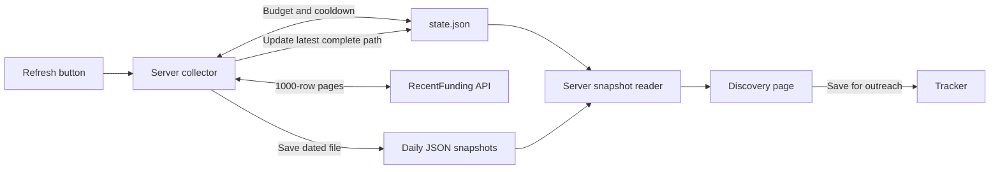

# RecentFunding API approach

RecentFunding Free allows 10 calls per day and hides companies newer than 14 days, plus stealth companies. We currently assume redaction happens after pagination; this needs verification.

As a user, i'd love to get the last day/week before the 14 days limit, so i can follow up and email those companies.

For now, we won't consider the companies before our current available week.

## Chosen approach: large company pages

- Start with `/companies?sort=announced&limit=1000&offset=0`.
- At roughly 30 companies/day, 14 hidden days plus 7 target days means about 630 rows. A 1,000-row page gives roughly 59% headroom.
- This estimate assumes global upstream volume before our US filter. Stealth entries and volume spikes may require more pages.
- Keep US/unknown-location companies announced 14–21 days ago, using explicit UTC boundaries. Deduplicate by slug; do not stop at 50 matches.
- Follow returned `next_offset`, including through empty pages, until dates pass the window's oldest boundary or pagination ends.
- Save results locally and refresh at most once daily. Allow at most eight calls per day, leaving two for recovery.
- Label coverage partial if the budget runs out before covering the week. Preserve the last successful snapshot if refresh fails.
- Exclude older companies from discovery; retain companies already saved in the tracker.

Expected normal case: one call covers the week. Pagination remains the fallback, not a guessed offset.

## Key players (planned)

| Component | Job |
| --- | --- |
| Refresh button | Manually starts collection; no scheduler. |
| Server collector | Prevents overlapping runs, checks budget/cooldown, fetches pages, and saves results. |
| RecentFunding API | Supplies company pages; only the collector calls it. |
| `data/recent-funding/state.json` | Stores UTC daily call count, cooldown, and latest complete snapshot path. |
| `data/recent-funding/snapshots/YYYY-MM-DD.json` | Archives that day's companies, fetch time, target window, and coverage. |
| Discovery page | Reads the latest complete snapshot through our server; shows freshness. |
| Tracker | Keeps companies saved for outreach, independent of discovery snapshots. |

Save the snapshot atomically, then update the pointer in `state.json`. Failed or partial refreshes keep the previous complete snapshot selected. No complete snapshot means an empty state with the refresh button.

## Alternatives considered

Target: funding announced 14–21 days ago; optionally show only the newest available day.

| Approach | Summary | Pros | Cons |
| --- | --- | --- | --- |
| **Company pages (recommended)** | Sort by announcement date; fetch large pages using `next_offset` until the target week is covered. | Full company records; includes undisclosed raises. | Hidden pages consume calls; empty-page pagination needs verification. |
| **Rounds feed** | Use `since` at the week's start; paginate and deduplicate companies. | Date filter; matches funding events directly. | Excludes unknown amounts; may need company lookups. |
| **Offset search** | Probe offsets to locate the available week, then fetch it. | Could save calls when many pages are hidden. | More complex; moving offsets and empty pages make probes unreliable. |

For every approach: save results locally, refresh at most daily, cap calls below 10/day, and label incomplete coverage. Never fill gaps with older companies.

Assumption to verify: Free-plan redaction happens after pagination, and empty pages retain a usable `next_offset`.
